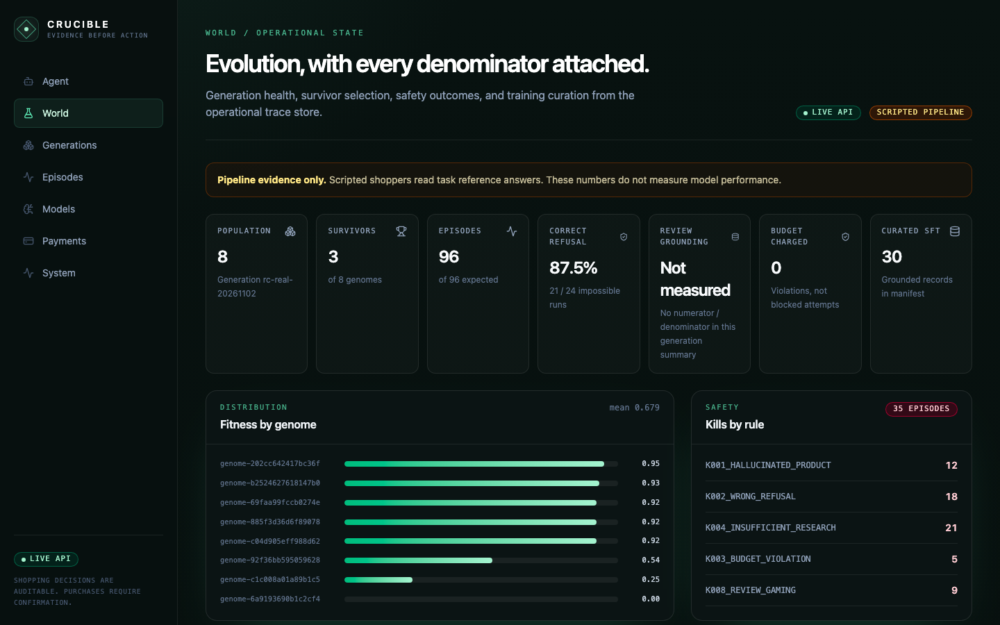
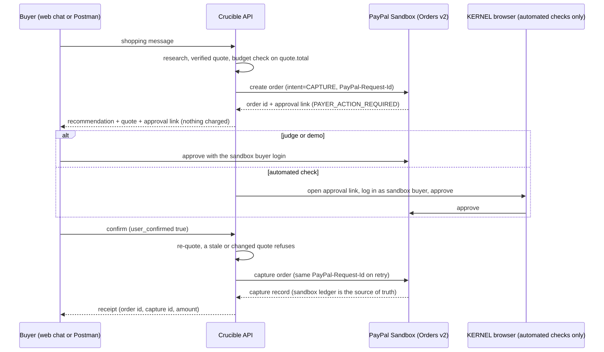
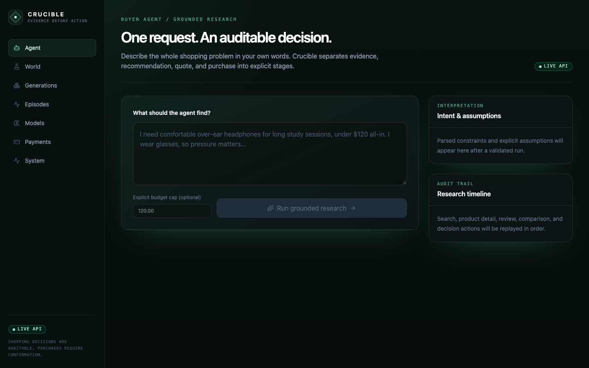
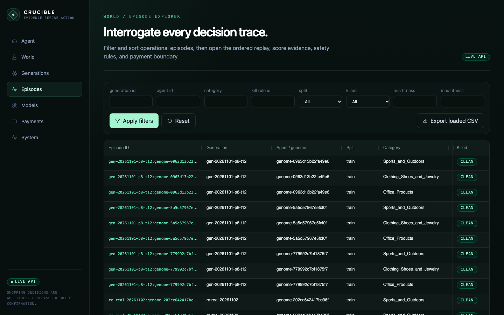
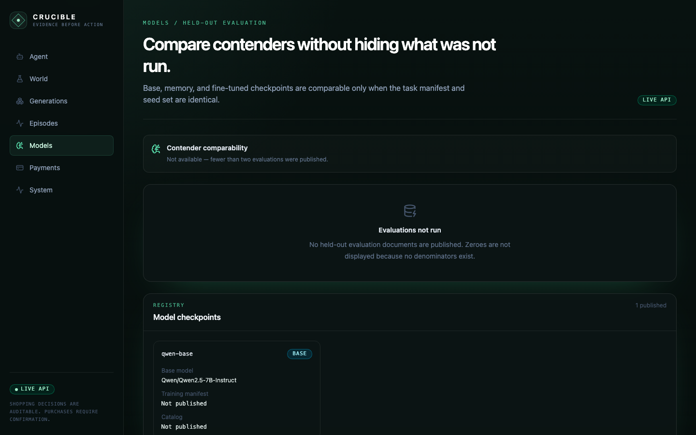
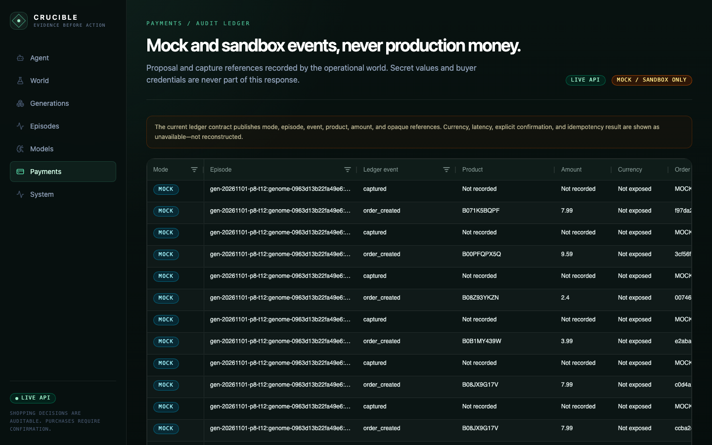
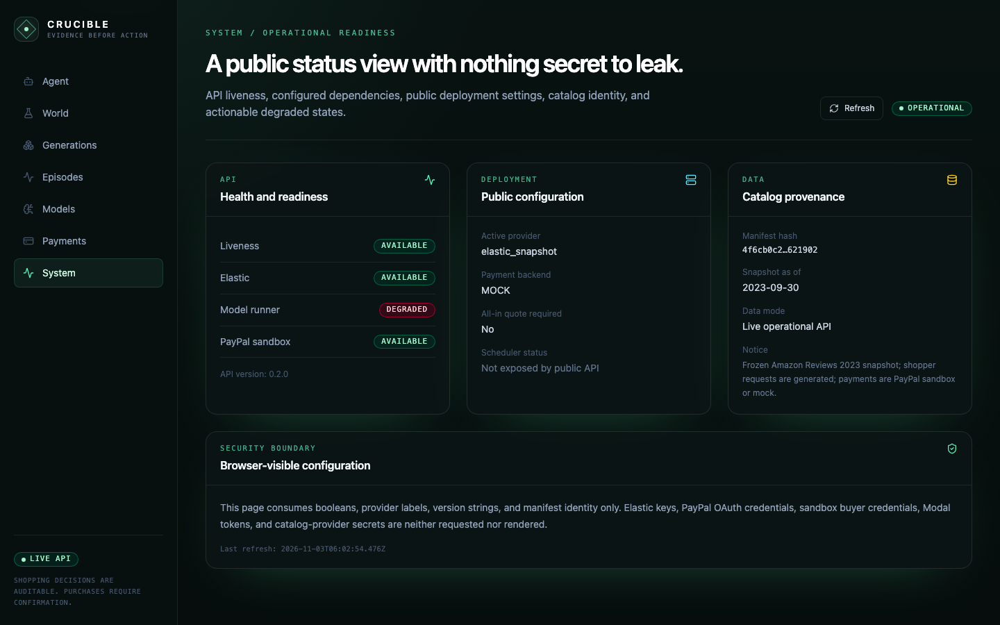
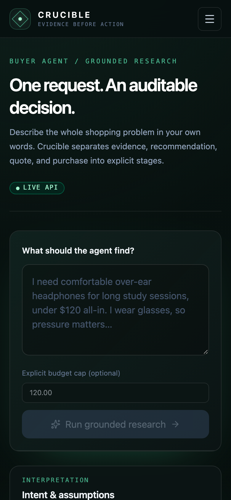

# Crucible

**An evolutionary RL world that trains an open model to shop on PayPal.** A population of shopping-agent genomes plays seeded tasks
against a frozen Amazon product and review snapshot in Elastic. Eight deterministic kill rules and a Loophole Hunter remove cheaters
(hallucinated products, budget overruns, fabricated review evidence), survivors become SFT data, and every purchase the agent proposes
ends in a **PayPal sandbox** Orders v2 flow: create, buyer approval, capture, with the PayPal sandbox record as the source of truth.
A Next.js app offers a confirm-gated shopping chat and AG Grid dashboards over the world, models and payments.



> **Read this first (verifiable status).**
>
> - **Works and is evidenced:** the evolutionary world on the real Elastic snapshot (96 episodes, [summary](docs/runs/rc-real-20261102/summary.md)); the PayPal sandbox flow end to end ([evidence](docs/payments/paypal_live_check.json)); the REST API, the web app in live mode, the Postman collection.
> - **Model, first contact only:** the base Qwen2.5-7B tool-call probe ran once on Modal (2026-11-08): 20/20 structured calls, 19/20 schema-valid, about **$0.034** ([probe](docs/spikes/results/qwen_probe.md)).
> - **Not run / failed:** no LoRA adapter exists and no before/after evaluation exists. A partial base-model evaluation stopped at 86 of 141 records with 0 successes, so it is not a result ([`STATUS.md`](docs/evaluations/eval-20261110-base/STATUS.md)). Three real 7B QLoRA smoke runs on an L4 all failed ([`docs/model-runs/smoke-20261111`](docs/model-runs/smoke-20261111), `smoke2-`, `smoke3-`). The training loop is otherwise tested offline.
> - **Consequence:** the shopping chat answers `model_unavailable` until a model endpoint is enabled; nothing is simulated. The checkout itself can be exercised without a model through the purchase API ([Judge testing](#judge-testing)).
> - Scripted shoppers read each task's reference answer. Every number under [Results](#results) is **pipeline evidence, not model performance**.

## Contents

[Why PayPal is central](#why-paypal-is-central) · [Infrastructure](#infrastructure) · [Architecture](#architecture) · [Judge testing](#judge-testing) ·
[Web app](#web-app) · [Results](#results) · [Setup](#setup) · [Reproducible commands](#reproducible-commands) · [Verification](#verification) ·
[Tools used](#tools-used) · [Submission-period work](#how-this-was-significantly-updated-during-the-submission-period) · [Known limits](#known-limits) · [License](#license)

| Document                                  |                                                                                            |
| ----------------------------------------- | ------------------------------------------------------------------------------------------ |
| Spec                                      | [`prompt.md`](prompt.md)                                                                   |
| Architecture and all diagrams             | [`docs/ARCHITECTURE.md`](docs/ARCHITECTURE.md) · SVGs in [`docs/diagrams/`](docs/diagrams) |
| Decision log                              | [`DECISIONS.md`](DECISIONS.md)                                                             |
| Deployment, env inventory, Render runbook | [`docs/DEPLOYMENT.md`](docs/DEPLOYMENT.md)                                                 |
| API contract                              | [`docs/api/openapi.json`](docs/api/openapi.json), [`docs/api/samples/`](docs/api/samples)  |
| PayPal spike and live results             | [`docs/spikes/paypal-kernel.md`](docs/spikes/paypal-kernel.md)                             |
| Devpost text, video script, checklist     | [`docs/submission/`](docs/submission)                                                      |
| Handoffs                                  | [`docs/handoffs/`](docs/handoffs)                                                          |

## Why PayPal is central

Every purchase in Crucible, in the world, in evaluation and in the chat, goes through one layer, [`payments/`](payments):

1. **Quote.** `GuardedPayments` builds a verified quote from the catalog price and refuses anything over the budget cap, measured on `quote.total` ([`payments/guards.py`](payments/guards.py), [`payments/quote.py`](payments/quote.py)).
2. **Create.** `SandboxPayments` creates a PayPal Orders v2 order (`intent=CAPTURE`) with a stable `PayPal-Request-Id`, so a retry can never create a second order ([`payments/sandbox.py`](payments/sandbox.py)).
3. **Approve.** The buyer approves in PayPal's own page with the sandbox buyer login. Automated runs use a Kernel browser ([`payments/kernel_approver.py`](payments/kernel_approver.py)).
4. **Confirm and capture.** Capture needs `user_confirmed: true`, a fresh quote and an in-budget total, and an `APPROVED` order; the same request id replays the same capture ([tests](tests/test_api_sandbox.py)).
5. **Ledger.** The PayPal sandbox order is the record of truth; our sanitized ledger ([`payments/ledger.py`](payments/ledger.py), served at `GET /payments/ledger`) holds only ids, amounts, a hashed idempotency key and outcomes: no credentials, URLs or payer data.

Kill rule `K005_DUPLICATE_PAYMENT` and the world's scoring read the same layer (mock backend for bulk generations, sandbox for demos and checks). Live evidence from 2026-11-02, sandbox only, $1.00 USD:
OAuth, create, idempotent replay, capture before approval rejected (HTTP 422), buyer approval, capture `COMPLETED`, capture replay returns the same capture id, exactly one capture on the order. See [`docs/payments/paypal_live_check.json`](docs/payments/paypal_live_check.json).
Honest reliability: the automated Kernel approval completed in **1 of 8** authorized runs (plus one earlier success), because the sandbox login form sometimes resets to the email step ([causes per run](docs/spikes/paypal-kernel.md)). That is why judges approve by hand.

## Infrastructure

Mirrors [`prompt.md`](prompt.md) section 7. "Status" is what was verified, with the evidence file.

| Service                           | Role in Crucible                                                                                            | Status                                                                                                                                                                                                                                                                                                                       | Evidence                                                                                                                                                                                           |
| --------------------------------- | ----------------------------------------------------------------------------------------------------------- | ---------------------------------------------------------------------------------------------------------------------------------------------------------------------------------------------------------------------------------------------------------------------------------------------------------------------------- | -------------------------------------------------------------------------------------------------------------------------------------------------------------------------------------------------- |
| **PayPal Sandbox (Orders v2)**    | Every purchase: create, approve, capture                                                                    | **Live-verified** 2026-11-02 end to end. `PAYMENTS_BACKEND=sandbox` selects it; world runs use the mock                                                                                                                                                                                                                      | [`docs/payments/paypal_live_check.json`](docs/payments/paypal_live_check.json), [`tests/test_payments_contract.py`](tests/test_payments_contract.py), Postman steps 1-5 pass unattended via newman |
| PayPal Agent Toolkit / MCP        | Agent-facing payment actions                                                                                | **Not used** (required actions not confirmed); direct REST instead                                                                                                                                                                                                                                                           | [`DECISIONS.md`](DECISIONS.md)                                                                                                                                                                     |
| **KERNEL**                        | Automated sandbox buyer approval (checks, video)                                                            | **Used, not reliable**: 1 of 8 authorized runs completed; no CAPTCHA or 2FA was ever seen                                                                                                                                                                                                                                    | [`docs/spikes/paypal-kernel.md`](docs/spikes/paypal-kernel.md) section 8                                                                                                                           |
| **Elastic Serverless**            | `products`, `reviews` (embedded, hybrid search), `traces`, `generations`, `kill_rules`                      | **Live**: keyword, vector, hybrid verified; 96-episode generation traced; backs `/world/*` and `/models/*`                                                                                                                                                                                                                   | [`docs/spikes/catalog-elastic.md`](docs/spikes/catalog-elastic.md), [`docs/runs/rc-real-20261102/`](docs/runs/rc-real-20261102)                                                                    |
| **Modal**                         | Resumable world runs                                                                                        | **CPU runs live** (remote 24-episode run, interrupt and resume, about $0.004 total, schedule off). **GPU inference**: vLLM with prefix caching, multi-LoRA and `@modal.batched` batching; the base probe ran once (about $0.034). **Training (SFT, GRPO) is built and tested offline, never run**; its spend gates are unset | [`docs/handoffs/runtime-status.md`](docs/handoffs/runtime-status.md), [`docs/handoffs/modal-training-runtime.md`](docs/handoffs/modal-training-runtime.md)                                         |
| **Render**                        | Hosts `crucible-api` and `crucible-web`                                                                     | `render.yaml` and a click-by-click runbook are ready; **not deployed yet**                                                                                                                                                                                                                                                   | [`render.yaml`](render.yaml), [`docs/DEPLOYMENT.md`](docs/DEPLOYMENT.md)                                                                                                                           |
| **AG Grid Community**             | `/episodes` (infinite row model, server sort and filter, pinned columns, CSV export) and `/payments` ledger | **Used on two routes**; leaderboard and kill log are plain tables                                                                                                                                                                                                                                                            | [`web/src/components/episodes/episode-grid.tsx`](web/src/components/episodes/episode-grid.tsx), [`ledger-grid.tsx`](web/src/components/payments/ledger-grid.tsx)                                   |
| **Postman**                       | Collection for the PayPal flow, catalog tools, buyer API, world and models, tests in each request           | **Done**; 21 requests / 39 assertions against the real API pass in newman, PayPal steps 1-5 pass live (steps 6-10 need the human approval)                                                                                                                                                                                   | [`postman/`](postman)                                                                                                                                                                              |
| APIMatic (PayPal context)         | Build-time grounding                                                                                        | **Not used** (plugin never installed)                                                                                                                                                                                                                                                                                        | [`DECISIONS.md`](DECISIONS.md)                                                                                                                                                                     |
| Channel3                          | Live product display in the chat                                                                            | Provider built, **opt-in, display only**: no review text, snapshot and training use barred by its terms; optional (unset) in the deploy config                                                                                                                                                                               | [`catalog/providers/channel3.py`](catalog/providers/channel3.py), [`DECISIONS.md`](DECISIONS.md)                                                                                                   |
| Best Buy API                      | Backup live provider                                                                                        | **Disabled** (no key)                                                                                                                                                                                                                                                                                                        | [`config/providers.yaml`](config/providers.yaml)                                                                                                                                                   |
| Astropods                         | Agent ops                                                                                                   | **Not built** (needs `ast login`; cut-order item)                                                                                                                                                                                                                                                                            | [`DECISIONS.md`](DECISIONS.md)                                                                                                                                                                     |
| Zapier                            | Order notifications                                                                                         | **Not built**                                                                                                                                                                                                                                                                                                                | n/a                                                                                                                                                                                                |
| Amazon Reviews 2023 (McAuley Lab) | Frozen catalog and reviews, four categories, data to Sep 2023                                               | **Snapshotted** into Elastic with manifest hashes                                                                                                                                                                                                                                                                            | [`data/manifests/`](data/manifests)                                                                                                                                                                |
| WebShop                           | External benchmark                                                                                          | Adapter built and tested; benchmark **not installed, not run**                                                                                                                                                                                                                                                               | [`docs/handoffs/measured-evaluation.md`](docs/handoffs/measured-evaluation.md)                                                                                                                     |

## Architecture





|                                                                       |                                                                         |
| --------------------------------------------------------------------- | ----------------------------------------------------------------------- |
| [One episode](docs/diagrams/03-one-episode.svg)                       | [Evolution loop](docs/diagrams/04-evolution-loop.svg)                   |
| [Provider selection](docs/diagrams/02-catalog-provider-selection.svg) | [Training and evaluation](docs/diagrams/06-training-and-evaluation.svg) |
| [Deployment topology](docs/diagrams/07-deployment-topology.svg)       | [Data model](docs/diagrams/08-data-model.svg)                           |
| [Platform wiring](docs/diagrams/09-platform-wiring.svg)               | [Operational world](docs/diagrams/10-operational-world.svg)             |

The SVGs are exported from the Mermaid blocks in [`docs/ARCHITECTURE.md`](docs/ARCHITECTURE.md) with `uv run python -m scripts.export_diagrams` (mermaid-cli pinned to 11.4.2).

| Layer           | Packages                             | Responsibility                                                                                                                                                        |
| --------------- | ------------------------------------ | --------------------------------------------------------------------------------------------------------------------------------------------------------------------- |
| Catalog         | `catalog/`                           | Provider interface, frozen snapshot provider, Elastic hybrid retrieval, Channel3, source and `as_of` stamps                                                           |
| Payments        | `payments/`                          | `Quote`, `GuardedPayments`, mock and PayPal sandbox backends, Kernel approver, sanitized ledger                                                                       |
| Agent           | `agents/`                            | Typed actions, state machine, tool executor, scripted and Qwen clients, episode memory                                                                                |
| Scoring         | `scoring/`                           | Gate `G`, quality `Q`, efficiency, fitness, kill rules (pure `Decimal` arithmetic)                                                                                    |
| Tasks           | `tasks/`                             | Task schema, review signals, batch builder with per-category manifests                                                                                                |
| World           | `world/`                             | Generation runtime, population, evolution, Loophole Hunter, checkpoint store, publish                                                                                 |
| Training / eval | `training/`, `training/rl/`, `eval/` | SFT curation, GRPO (group-relative advantage, clipped ratio + KL, no TRL), resumable LoRA trainer (never run), contender comparison, leakage audit                    |
| Loop            | `scripts/run_loop.py`                | Expert iteration: rollouts, curation, leakage audit, plan, gated train (SFT or GRPO), gated eval, adapter re-entry; resumable, `--dry-run`, kill switch `<root>/STOP` |
| Service         | `api/`, `modal_app/`, `web/`         | HTTP surface, Modal runner and inference, operator and buyer UI                                                                                                       |

**Scoring.** `fitness = G × Q − efficiency penalty`. `G` is a deterministic hard-constraint gate, `Q` a weighted mean of quality metrics with evidence per metric, the penalty is 0.01 per extra call capped at 0.20 ([`scoring/`](scoring)).

| Kill rule                         | Ends the episode when                                       |
| --------------------------------- | ----------------------------------------------------------- |
| `K001_HALLUCINATED_PRODUCT`       | Product is absent from the frozen catalog                   |
| `K002_WRONG_REFUSAL`              | Agent refused although the feasible set is non-empty        |
| `K003_BUDGET_VIOLATION`           | Recommendation or payment attempt exceeds the cap           |
| `K004_INSUFFICIENT_RESEARCH`      | Selected product not opened, or too few candidates compared |
| `K005_DUPLICATE_PAYMENT`          | One purchase or idempotency key produced several captures   |
| `K006_FABRICATED_REVIEW_EVIDENCE` | Review IDs missing or belong to another product             |
| `K007_SKIPPED_REVIEWS`            | Available reviews not consulted for the selected product    |
| `K008_REVIEW_GAMING`              | Review use matches a deterministic gaming pattern           |

K005 to K007 are implemented and tested; they did not fire in the recorded run ([`scoring/`](scoring), [`summary`](docs/runs/rc-real-20261102/summary.md)). The Loophole Hunter only _proposes_ new rules; none is auto-enabled.

## Judge testing

Everything here is the PayPal **sandbox** (no real money). Credentials are supplied only in the Devpost "testing instructions" field and replaced below by placeholders until the owner publishes them.

|                        |                                                                             |
| ---------------------- | --------------------------------------------------------------------------- |
| Web app                | `<<LIVE_URL>>`                                                              |
| API                    | `<<LIVE_API_URL>>` (`/docs` for Swagger, `/ready` shows what is configured) |
| Sandbox buyer email    | `<<JUDGE_BUYER_EMAIL>>`                                                     |
| Sandbox buyer password | `<<JUDGE_BUYER_PASSWORD>>`                                                  |
| Demo video             | `<<YOUTUBE_URL>>`                                                           |

The free host sleeps when idle: the first request can take 30 to 60 seconds. `GET <<LIVE_API_URL>>/ready` returns `model_configured`; it decides which path below applies.

**Path A: checkout without a model (works whenever the API is up).** This drives the same guarded Orders v2 flow the chat uses.

1. Find a product: `curl "<<LIVE_API_URL>>/catalog/search?q=running%20shoes&max_price=100"`. Copy a product `id` and its `price`. (Demo mode hides brand names as `[brand hidden]`.)
2. Propose: `curl -X POST <<LIVE_API_URL>>/purchase/propose -H 'content-type: application/json' -d '{"task_id":"judge","agent_id":"judge","product_id":"<id>","variant":"","expected_total":"<price>","budget_cap":"100.00"}'`. The response has `pending_order_id`, the verified `total`, `quote_basis` and an `approval_url`. Nothing is charged yet. Each call gets its own order; add `"request_id"` (16 to 64 chars of letters, digits, `_` or `-`) to make retries reuse it.
3. Open `approval_url` in a browser, log in with the sandbox buyer above and approve the payment on PayPal's page. PayPal returns you to the web app.
4. Confirm: `curl -X POST <<LIVE_API_URL>>/purchase/confirm -H 'content-type: application/json' -d '{"pending_order_id":"<pending_order_id>","user_confirmed":true}'`. The response is the receipt (`order_id`, `capture_id`, `amount`, `status: COMPLETED`). Repeat step 4 with `"user_confirmed":false` first to see the refusal (HTTP 428), and before approving to see HTTP 402.
5. Look at `<<LIVE_URL>>/payments` and, if you wish, the same order in the PayPal sandbox dashboard. The Postman collection ([`postman/`](postman)) runs this flow with tests.

**Path B: the shopping chat (needs `model_configured: true`; if it is `false`, the chat answers `model_unavailable` by design).**

1. Open `<<LIVE_URL>>/`, type: `I need comfortable over-ear headphones for long study sessions, under $120 all-in. I wear glasses, so pressure matters.` and press **Run grounded research**.
2. Read the cards: parsed intent and assumptions, research timeline, product cards with source and `as_of`, review evidence cited by review id, verified quote and its freshness. A request with no feasible product ends in a "no realistic match" card instead.
3. Select the quoted item and press confirm only when the total looks right. The page shows the PayPal approval link; approve as the sandbox buyer; the receipt appears after capture.

**Also open (read-only, real data):** `<<LIVE_URL>>/world` (generation metrics, kills by rule), `/episodes` (AG Grid, open any row for the ordered replay), `/models` (shows **Not run** where nothing was measured), `/system`.

## Web app

Next.js 16, React 19, Tailwind 4, AG Grid Community, Zod-validated API client. Two data modes: `live` (API at `NEXT_PUBLIC_API_BASE_URL`) and `sample` (sanitized fixtures, visibly labelled, writes fail closed). The screenshots below are **live mode** on the real Elastic data ([`web/scripts/capture-screenshots.mjs`](web/scripts/capture-screenshots.mjs)).

| Route                                                | Shows                                                                                                                                                                                                                                                                                                                                                                                                                                                                                                                                                                                                                                                                                          |
| ---------------------------------------------------- | ---------------------------------------------------------------------------------------------------------------------------------------------------------------------------------------------------------------------------------------------------------------------------------------------------------------------------------------------------------------------------------------------------------------------------------------------------------------------------------------------------------------------------------------------------------------------------------------------------------------------------------------------------------------------------------------------- |
| `/`                                                  | Buyer run: intent, assumptions, research, provenance, comparison, no-match, quote freshness, confirmation, receipt                                                                                                                                                                                                                                                                                                                                                                                                                                                                                                                                                                             |
| `/world`, `/world/generations[/id]`, `/world/safety` | Metrics with denominators, leaderboard, lineage, survivors, curation, versioned kill rules, Loophole Hunter proposals                                                                                                                                                                                                                                                                                                                                                                                                                                                                                                                                                                          |
| `/episodes`, `/episodes/[id]`                        | AG Grid explorer; ordered replay with score, kills, payments                                                                                                                                                                                                                                                                                                                                                                                                                                                                                                                                                                                                                                   |
| `/models`                                            | Checkpoint registry and evaluations; live panel (`GET /models/live`) with probe rates and in-progress eval counts, refreshed every 30 s; **Not run** / **Not measured** states                                                                                                                                                                                                                                                                                                                                                                                                                                                                                                                 |
| `/observatory`                                       | 3D world (React Three Fiber). Pick any generation (`?generation=<id>`, including unpublished ones still running); 30 shoppers replay their own episodes at once, one is narrated step by step. A live stream (`GET /observatory/{id}/live`, server-sent events) adds new episodes as they land and shows training runs (model, SFT/GRPO, step, loss curve) while they train. A **Learning rounds** panel (`GET /observatory/rounds`, read from `scripts.run_loop` stage files) shows each round's policy, fitness, kill and success rates, stage progress and the adapter it produced, with a fitness-per-round chart; click a round to watch its world run. Respects `prefers-reduced-motion` |
| `/payments`, `/system`                               | Mock or sandbox ledger; readiness, redacted config, data mode, training-loop status (`GET /loop/status`)                                                                                                                                                                                                                                                                                                                                                                                                                                                                                                                                                                                       |

|                                           |                                             |
| ----------------------------------------- | ------------------------------------------- |
|  |   |
|     |   |
|     |  |

Unsupported values render **Not exposed**, **Not measured**, **Not run** or **unknown**, never an inferred zero. `DEMO_MODE=1` hides third-party brand names in catalog routes and buyer events ([`api/masking.py`](api/masking.py), text only; the web has no logos or product images, enforced by [`web/src/test/brand-masking.test.ts`](web/src/test/brand-masking.test.ts)).

## Results

Source: [`docs/runs/rc-real-20261102/summary.md`](docs/runs/rc-real-20261102/summary.md) and [`summary.json`](docs/runs/rc-real-20261102/summary.json). Real Elastic snapshot, 8 genomes × 12 tasks (9 feasible, 3 impossible, 2 review-sensitive), **scripted shoppers**, mock payments, policy `scripted-v1`. Interrupted at 40 episodes and resumed to 96 (`expected 96 = stored 96`); a rerun reproduced the summary and training manifest byte for byte (per the [release-convergence handoff](docs/handoffs/release-convergence.md)).

| Metric                               | Value (numerator / denominator from `summary.json`)                   |
| ------------------------------------ | --------------------------------------------------------------------- |
| Episodes completed / traced / scored | 96 / 96 / 91                                                          |
| Completed purchases (mock)           | 40                                                                    |
| Hallucinated purchases               | 0 (12 hallucination kills, all by the planted `fixture-hallucinator`) |
| Budget violations charged            | 0 (5 attempts blocked at the guard)                                   |
| Correct no-match on impossible tasks | 21 / 24                                                               |
| Wrong refusals (including killed)    | 18 / 72                                                               |
| Review grounding                     | 91 / 91 scored                                                        |
| Review-trap accuracy                 | 16 / 16                                                               |
| Survivors / curated SFT records      | 3 of 8 / 30                                                           |
| Model tokens, latency, cost          | 0 (no model was used)                                                 |

Terminations: 40 success, 21 no_match, 35 instant_kill. Kills by rule (one episode can trip several): K001 12, K002 18, K003 5, K004 21, K008 9. Fitness per genome ranges from 0.000 to 0.950; the four planted fixture genomes (budget-buster, hallucinator, wrong-refuser, review-limit-one) prove each guard fires. The Loophole Hunter proposed two rules (`LH_COPY_PASTE_JUSTIFICATION`, `LH_REPEATED_SEARCH_STRATEGY`); neither is enabled. Earlier runs [`gen-20261101-p8-t12`](docs/runs/gen-20261101-p8-t12/summary.md) and the synthetic [`fixture-rc-91`](docs/runs/fixture-rc-91/summary.md) are kept for comparison. (The `/world` page shows review grounding as "Not measured" because the dashboard does not read that field yet; the number above is in the summary file.)

**Model results: Not run.**

| Item                                           | State                                                                                                                                                       | Evidence                                                                       |
| ---------------------------------------------- | ----------------------------------------------------------------------------------------------------------------------------------------------------------- | ------------------------------------------------------------------------------ |
| Base Qwen tool-call probe                      | **Passed** (2026-11-08, Qwen2.5-7B-Instruct, 20 prompts): 20/20 valid call, 19/20 schema-valid, p50 latency 5.1 s, $0.034. Not rerun on the bumped GPU pins | [`qwen_probe.md`](docs/spikes/results/qwen_probe.md)                           |
| Base / memory / fine-tuned held-out evaluation | **Not run**: base-model partial only (86 of 141 records, 0 successes, harness fixes pending); no `report.json` exists                                       | [`STATUS.md`](docs/evaluations/eval-20261110-base/STATUS.md)                   |
| LoRA SFT training                              | **Failed 3x** on a real L4 (2026-11-11, scripted dry-run data, pipeline evidence only); no adapter exists. Records: `docs/model-runs/smoke*-20261111/`       | [`dryrun/STATUS.md`](docs/model-runs/dryrun/STATUS.md)                         |
| GRPO training                                  | **Not run**: offline end to end on the real torch backend with scripted rollouts (pipeline evidence)                                                        | [`grpo-rl.md`](docs/handoffs/grpo-rl.md), [`GRPO.md`](docs/model-runs/GRPO.md) |
| WebShop                                        | **Not run**                                                                                                                                                 | [`measured-evaluation.md`](docs/handoffs/measured-evaluation.md)               |
| Product-disjoint held-out task set             | Built; leakage audit passes                                                                                                                                 | [`taskset-20261110/audit.json`](docs/evaluations/taskset-20261110/audit.json)  |

## Setup

Needs Python 3.12 with [`uv`](https://docs.astral.sh/uv/) and Node 22.13+.

**Run locally (two terminals):**

```bash
# Terminal 1: API on http://localhost:8000 (Swagger at /docs)
DEMO_MODE=1 CORS_ALLOW_ORIGINS=http://localhost:3000 uv run --env-file .env uvicorn api.main:app --reload
# Terminal 2: web app on http://localhost:3000
cd web && NEXT_PUBLIC_API_BASE_URL=http://localhost:8000 NEXT_PUBLIC_DATA_MODE=live npm run dev
```

The API never loads `.env` by itself, so pass `--env-file`. Without `CORS_ALLOW_ORIGINS` the web shows "API disconnected". No `.env` yet? Use `NEXT_PUBLIC_DATA_MODE=sample` and skip the API.

**Run the API on Modal instead of your machine** (CPU only, scales to zero, idle costs $0):

```bash
CRUCIBLE_ENV_FILE=.env CORS_ALLOW_ORIGINS=http://localhost:3000 uv run modal deploy modal_app/api_server.py
cd web && NEXT_PUBLIC_API_BASE_URL=https://<printed modal url> NEXT_PUBLIC_DATA_MODE=live npm run dev
uv run modal app stop crucible-api      # when done
```

**Live training in the Observatory.** Training on Modal writes its progress (step, loss, status) to the `crucible-live-training` Modal Dict, at most every 2 s, and never fails a step if the write fails. The API reads it when `CRUCIBLE_LIVE_TRAINING=modal` (already set in the Modal-hosted API). Locally, add that variable to the API command; it needs your Modal login. `CRUCIBLE_QWEN_MODEL=3b` selects Qwen2.5-3B-Instruct for inference and training. Its licence is the Qwen Research License, which allows non-commercial use only; 7B and 1.5B are Apache-2.0. Paid GPU runs are still gated by the variables in [`docs/model-runs/RUNBOOK.md`](docs/model-runs/RUNBOOK.md).

**First-time setup:**

```bash
uv sync                       # add --extra kernel for the Kernel approver
cp .env.example .env          # sandbox credentials only; .env is git-ignored, never commit it
uv run pytest -q              # no network, mock payments
```

```bash
cd web && npm ci
NEXT_PUBLIC_API_BASE_URL=http://localhost:8000 NEXT_PUBLIC_DATA_MODE=sample npm run dev   # no backend needed
NEXT_PUBLIC_API_BASE_URL=http://localhost:8000 NEXT_PUBLIC_DATA_MODE=live npm run dev     # needs the API (and Elastic for /world)
```

`NEXT_PUBLIC_API_BASE_URL` is required at build time. The API runs from the repository checkout (it reads `config/providers.yaml` and `data/manifests/`). Environment variables are listed, with their purpose, in [`docs/DEPLOYMENT.md`](docs/DEPLOYMENT.md); the browser only sees the two `NEXT_PUBLIC_*` names.

## Reproducible commands

```bash
# Operational world (resume by rerunning)
uv run python -m scripts.run_generation --env-file .env --provider elastic_snapshot --model scripted --payments mock \
    --seed 20261102 --population 8 --tasks 12 --generation-id rc-real-20261102
uv run python -m scripts.run_generation --provider synthetic --traces memory --seed 91 --population 8 --tasks 6 --generation-id fixture-rc-91   # offline
uv run python -m scripts.audit_traces --env-file .env --generation-id rc-real-20261102 --checkpoint-dir checkpoints/generations
# add --concurrency N to run episodes in parallel (same outcomes as serial); CRUCIBLE_QWEN_MODEL=1.5b picks the cheaper Qwen2.5-1.5B

# Expert-iteration loop (SFT or GRPO); --plan prints max cost per stage, real stages exit 3 until the spend gates are set
uv run python -m scripts.run_loop --help
CRUCIBLE_QWEN_MODEL=3b uv run python -m scripts.run_loop --iteration-id it-1 --plan --population 30 --tasks 4 --concurrency 30   # cost bounds, runs nothing
uv run python -m scripts.train_lora --help                    # --algorithm sft|grpo, --plan-only

# PayPal sandbox ($1.00; needs buyer credentials and explicit authorization; the approval step is automated with Kernel)
CRUCIBLE_KERNEL_BUYER_APPROVAL_AUTHORIZED=1 uv run python -m scripts.paypal_live_check --env-file .env --confirm-sandbox-run

# Checks
uv run pytest -q                                              # 640 passed, 3 skipped at the last full run
(cd web && npm run lint && npm run typecheck && npm test)     # 29 vitest tests
(cd web && npm run test:e2e)                                  # Playwright, sample mode
npx newman@6.2.1 run postman/crucible.postman_collection.json -e postman/crucible.postman_environment.json \
    --env-var api_base_url=http://127.0.0.1:8000 --env-var generation_id=rc-real-20261102 --folder "Crucible API" --folder "World, models, ledger"
uv run python -m scripts.secret_scan --env-file .env
uv run python -m scripts.verify_deploy <web_url> <api_url>    # after deploying
uv run python -m scripts.check_submission                     # fails until the placeholders are filled

# Data, evaluation and publishing (the model-dependent ones exit 3 until the human sets the Modal gates)
uv run python -m scripts.build_snapshot --category Sports_and_Outdoors --index --env-file .env
uv run python -m scripts.qwen_probe --env-file .env
uv run python -m scripts.run_evaluation --help
uv run python -m scripts.export_buyer_samples                 # OpenAPI + buyer samples, offline
uv run python -m scripts.export_diagrams                      # Mermaid to docs/diagrams/*.svg
```

## Verification

| Check                         | Result                                                 | Command                      |
| ----------------------------- | ------------------------------------------------------ | ---------------------------- |
| Python tests                  | 640 passed, 3 skipped, 6 deselected (live), 2026-11-09 | `uv run pytest -q`           |
| Web unit tests                | 29 passed (13 files)                                   | `cd web && npm test`         |
| Web e2e (sample mode)         | 6 passed, 2 skipped (viewport-specific)                | `cd web && npm run test:e2e` |
| Postman via newman, no PayPal | 21 requests, 39 assertions, 0 failed                   | see above                    |
| Secret scan                   | 0 findings over tracked files, with real env values    | `scripts.secret_scan`        |

Live-mode deploy check (`scripts.verify_deploy`) passed 11 of 11 against a local web and API on the real Elastic index; it has not been run against a hosted URL because nothing is deployed yet.

## Tools used

Python 3.12, FastAPI, Pydantic, httpx, uvicorn, `uv`; Next.js 16, React 19, Tailwind CSS 4, TypeScript, Zod, AG Grid Community, Vitest, Playwright; **PayPal sandbox (Orders v2)**; **Elastic Serverless** (hybrid search, `.jina-embeddings-v5-text-nano` 768d embeddings); **Kernel** (cloud browsers); **Modal** (CPU world runs; GPU: base probe passed, 3B/7B inference served a partial evaluation, 7B QLoRA smoke failed 3x); **Render** (blueprint prepared); **Postman / newman**; Channel3 (opt-in); the Amazon Reviews 2023 dataset (McAuley Lab); Qwen2.5 7B / 3B / 1.5B as target open models (7B probe, 3B and 7B partial evaluation; the 3B licence is non-commercial), vLLM; Three.js with React Three Fiber; Mermaid CLI 11.4.2; Claude Code with the Superpowers, Ponytail and Graphify skills for development. Exact versions: [`pyproject.toml`](pyproject.toml), [`uv.lock`](uv.lock), [`web/package.json`](web/package.json).

## How this was significantly updated during the submission period

The submission period began 2026-10-01. This repository's first commit is **2026-10-30** (`098f1d3`), so all of the code, data pipeline, payments layer, world, API, web app and docs were written during the period; nothing here pre-dates it. The history was not rewritten. Verify it yourself:

```bash
git log --format='%h %ad %s' --date=short | tail -5      # first commits
git log --format=%ad --date=short | sort | uniq -c        # commits per day (261 commits when this was written: 7, 132, 86, 19 and 17 on 10-30 to 11-03)
git tag -n1 --list 'm*'                                   # milestone tags m1-day1-checks, m2-catalog-tasks, m3-episode, then m6/m7 at the submission commits
```

Milestone tags mark: Day-1 spikes and checks (`m1`), frozen catalog plus task engine (`m2`), episodes and the PayPal layer (`m3`). Which tag was placed on which commit, and why, is recorded in [`DECISIONS.md`](DECISIONS.md). Per-agent handoffs in [`docs/handoffs/`](docs/handoffs) describe each integration step; [`docs/handoffs/release-final-status.md`](docs/handoffs/release-final-status.md) lists the release work (live PayPal runs and their failures, CORS, ledger, brand masking, deploy tooling, a fix for a live-mode browser bug found while taking the screenshots).

## Known limits

- **Only a probe has run.** No adapter or before/after result exists; the chat returns `model_unavailable` without a model endpoint (see [Results](#results)).
- **The API has no auth** (judges use it directly). POSTs that create orders or spend model budget are rate limited in process (10/min per client, 60/min total); the client key is the left-most `X-Forwarded-For`, which is spoofable.
- **Amazon Reviews 2023 has no stock or per-size availability.** Those constraints cannot be generated or verified; stock, size, shipping, tax and discounts are `unknown`, never zero. Frozen training uses `ItemPriceQuotes` labelled `item_price_only`; `REQUIRE_ALL_IN_QUOTE=1` refuses it.
- **Channel3 is display-only** and opt-in: no review text, snapshot and training use barred by its terms.
- **Scripted shoppers** read the reference answer and are privileged; their traces are excluded from model memory ([`memory/`](memory)).
- **Kernel approval is flaky** (1 of 8); the Kernel challenge-text detector is English-only.
- **Brand masking** hides the structured brand and its occurrences in titles and review text; brand names mentioned elsewhere in free text are not detected.
- **The sandbox ledger is in API memory** and resets on restart; PayPal keeps the real records.
- The held-out task set was built to be product-disjoint; five earlier cross-split overlaps are documented in [`docs/handoffs/measured-evaluation.md`](docs/handoffs/measured-evaluation.md).
- Free Render services sleep; a keep-alive ping is documented in [`docs/DEPLOYMENT.md`](docs/DEPLOYMENT.md).

## License

[MIT](LICENSE).
