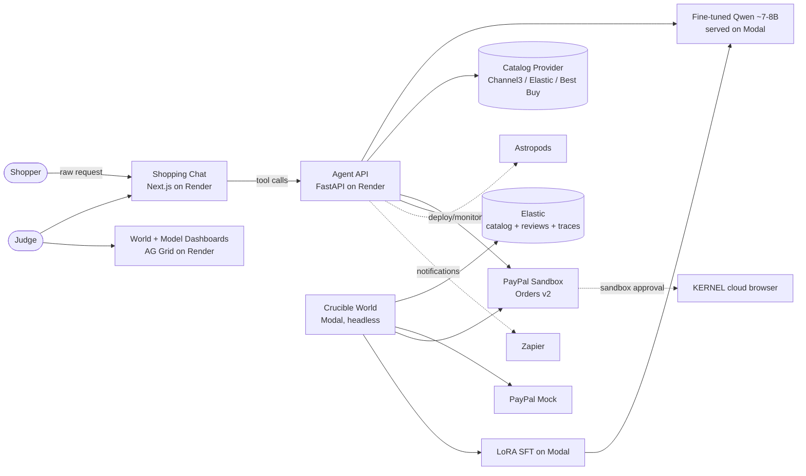
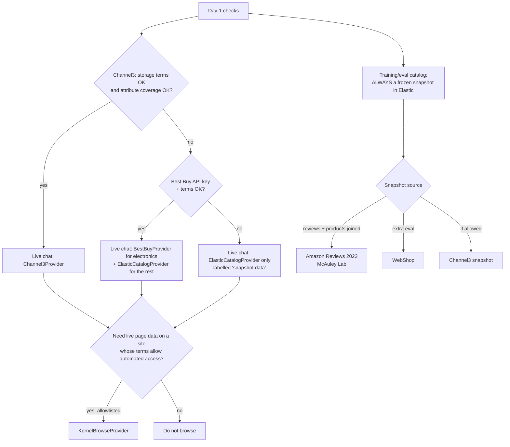
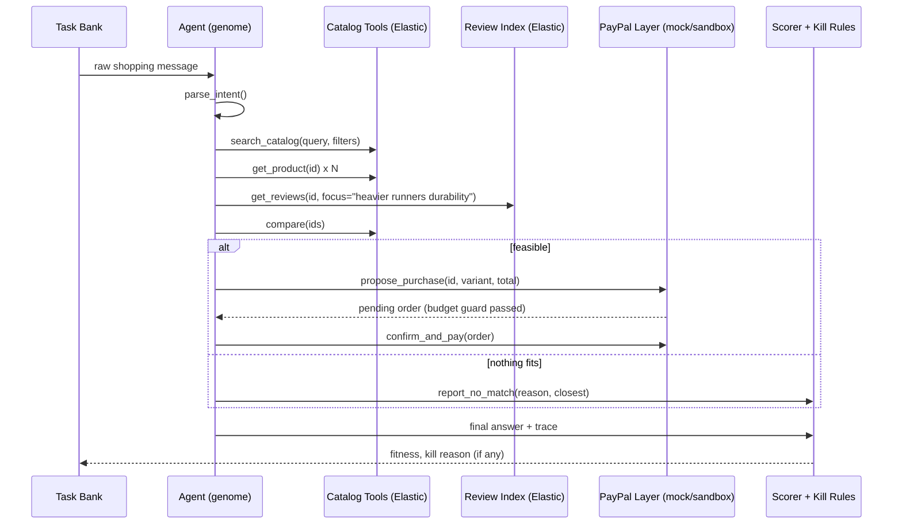
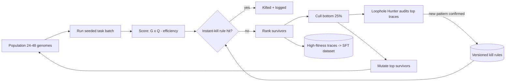
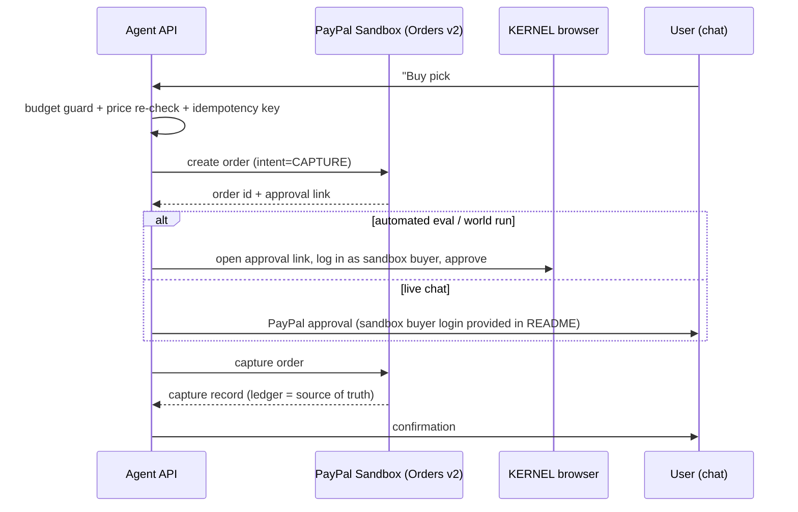
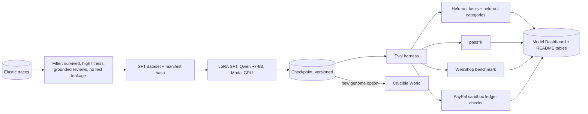
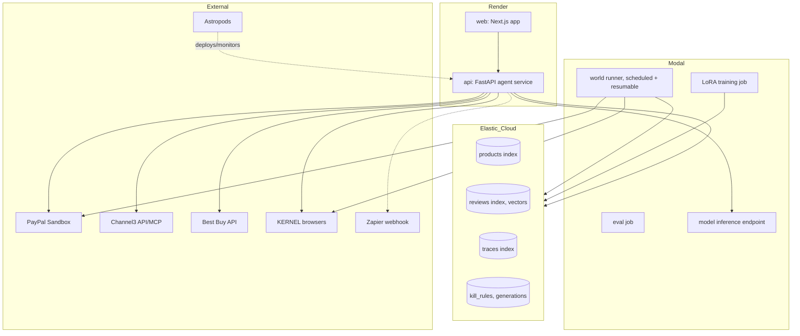
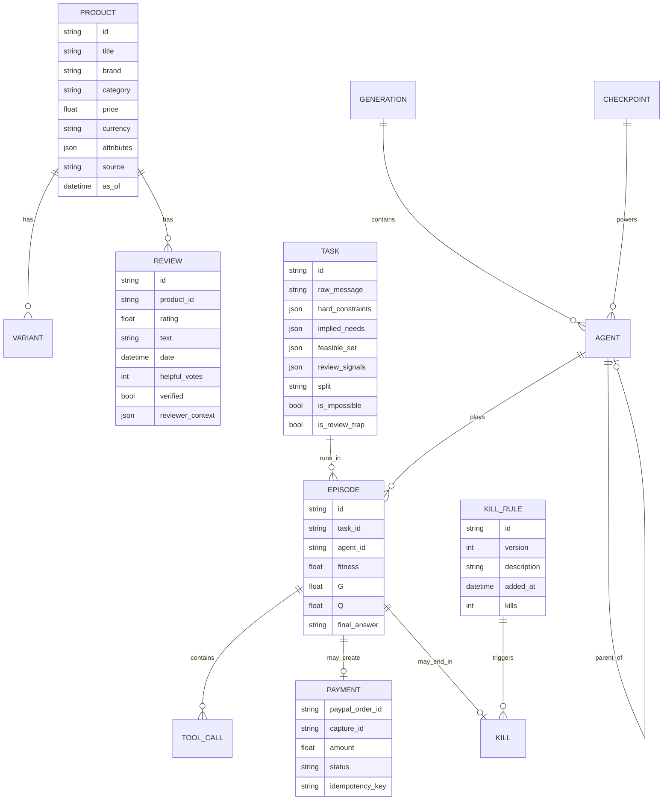

# Architecture

Diagrams copied from `prompt.md` sections 6 and 9. Keep in sync with code at each milestone.

## System context

## Catalog provider selection

## One episode

## Evolution loop

## Checkout

## Training and evaluation

## Deployment topology

## Data model

