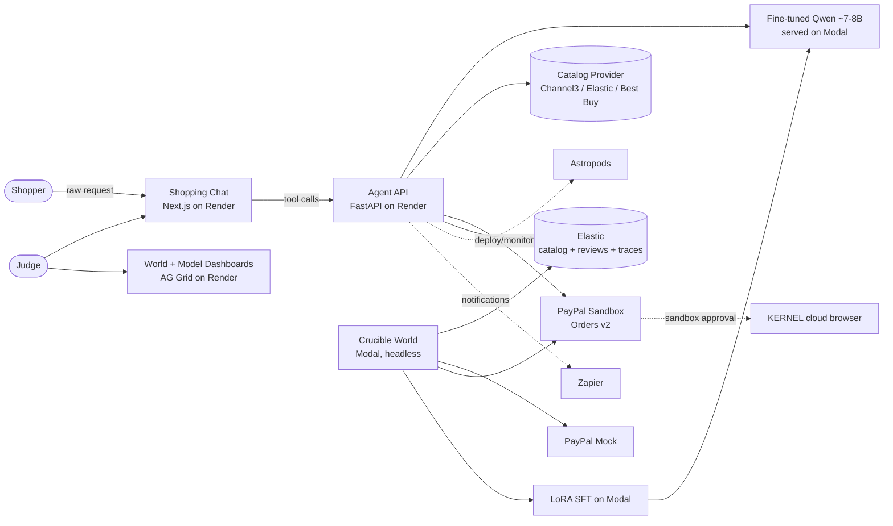
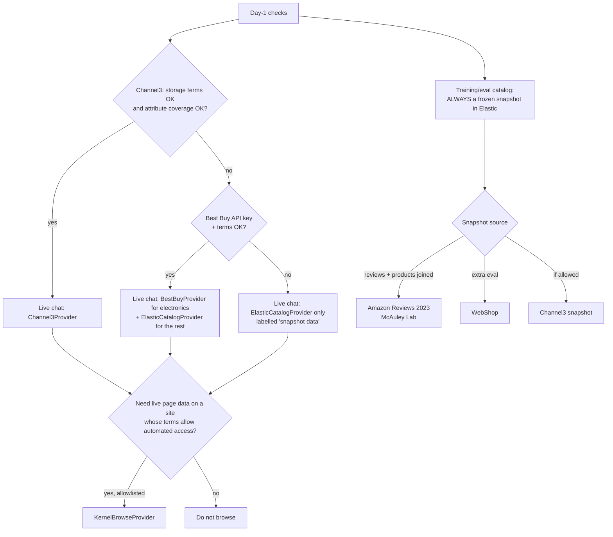
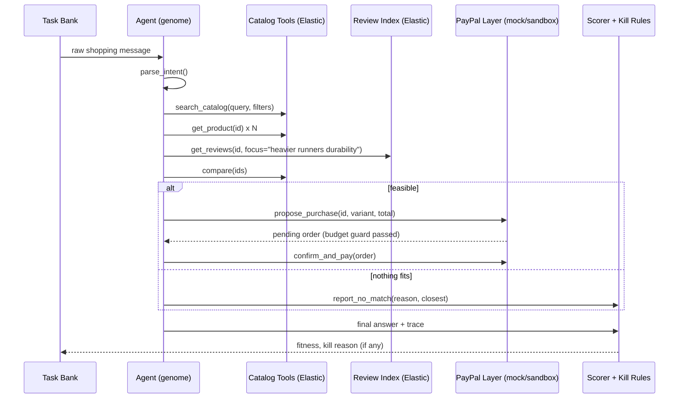
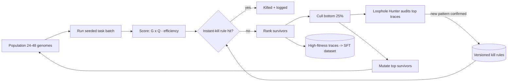
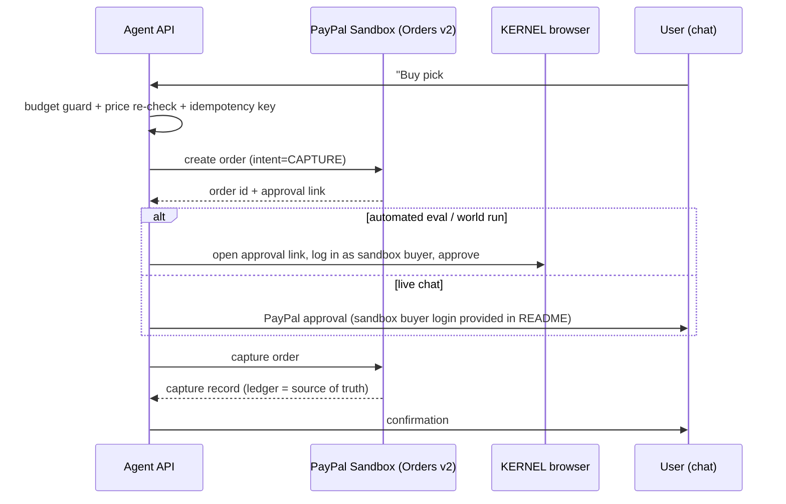
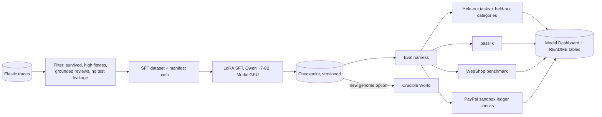
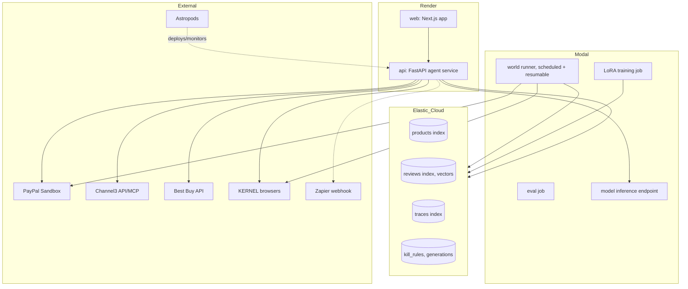
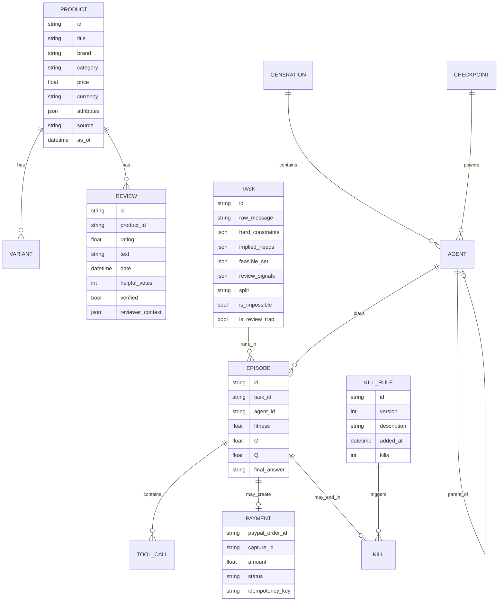

# Build Spec: Crucible — an evolutionary RL world that trains open models to shop on PayPal

> Working name: **Crucible** (rename freely).
> You are Claude Code acting as the **build agent** for this project. Read this entire file before writing any code. This file is the source of truth. When something here conflicts with your assumptions, this file wins. When something here conflicts with official documentation, the documentation wins, and you log the conflict in `DECISIONS.md`.

---

## Table of contents
0. Ground rules for you
1. The idea
2. Hackathon rules (official, non-negotiable)
3. The core skill the trained model must have
4. Required skills and dev tooling
5. Git workflow: commit every ~4 minutes
6. Architecture (mapped out)
7. **Infrastructure: every service, what it does, and exactly how we use it**
8. Component build specs
9. Data model
10. Product surface and design direction
11. Data terms and compliance
12. Evaluation
13. Repository layout
14. Non-functional requirements
15. Day-1 kill-checks
16. Milestones
17. Definition of done
18. Reference material

---

## 0. Ground rules for you (read first)

1. **Never invent APIs.** Before using any endpoint, SDK method, CLI command, or field from PayPal, Channel3, Elastic, AG Grid, Render, Modal, KERNEL, Astropods, Postman, Zapier, or Best Buy, verify it against the official docs. If you cannot verify it, stop and say so. Do not guess field names.
2. **Real data only where it matters.** Products, prices, specs, stock, and reviews come from real sources (Section 8.1). Shopper requests are generated, and that is disclosed openly. **Never fabricate products, prices, specs, stock, or reviews.**
3. **Verify, don't trust self-reports.** Every component ships with tests. Every claimed metric must be reproducible from a seeded command in the README.
4. **Log decisions.** Keep `DECISIONS.md` updated with every non-obvious choice, every doc-vs-spec conflict, every fallback taken, and every provider chosen by the Day-1 checks.
5. **Stop and report blockers** instead of hacking around them, especially anything in Section 15 (Day-1 kill-checks).
6. **No secrets in the repo.** Use environment variables and ship `.env.example`.
7. **Small, working increments.** Each milestone in Section 16 must end with something that runs end to end.
8. **Follow the official hackathon rules in Section 2** at every step. If an implementation choice could violate them, stop and flag it.

---

## 1. The idea

PayPal is betting on **agentic commerce**: AI agents that shop and pay on behalf of people. That only scales if agents can be trusted with money. They must:
- find real products that fit every constraint;
- read and correctly apply real reviews for the specific person;
- stay within budget;
- never hallucinate items;
- say "no realistic match" when nothing fits.

**Crucible** is a cloud-hosted RL world where **dozens of shopping agents compete on realistic shopping requests over a real product catalog, and check out through PayPal**.
- Agents that hallucinate, refuse wrongly, under-research, skip or fabricate reviews, or break budget are **killed**.
- Survivors reproduce with mutations (evolutionary selection).
- A **Loophole Hunter** finds score-gaming patterns and turns each one into a new kill rule.
- Survivors' winning traces become training data that fine-tunes an open model (**Qwen ~7–8B**) into a measurably better shopping agent.
- The trained model powers a real shopping chat: a person types one raw, messy request and gets real, in-budget, review-checked products they can buy with PayPal (sandbox).

**Pitch line:** "Agentic commerce only scales if shoppers and merchants can trust agents with money. Crucible is the proving ground where shopping agents earn that trust, on PayPal."

---

## 2. Hackathon rules (official, non-negotiable)

Source: PayPal AI Hackathon Official Rules (Devpost). If anything below conflicts with the current official rules page, the official page wins; log the change in `DECISIONS.md`.

**Dates**
- Submission period: **Oct 1, 2026 9:15 AM PT → Nov 12, 2026 12:00 PM PT.**
- Judging period: **Dec 1, 2026 2:00 PM PT → Dec 15, 2026 8:00 AM PT.**
- Winners announced around Dec 21, 2026.

**What must be built**
- An application that integrates the **PayPal developer platform, using the free sandbox**, plus an AI tool, model, or platform.
- PayPal services also count (Venmo, Braintree, Hyperwallet, Honey, Zettle, Xoom, Paidy, and others).
- **PayPal integration must be central to the project.** Sponsor tools (AG Grid, APIMatic, Astropods, Bryntum, Channel3, Elastic, KERNEL, Postman, Render, Zapier) are optional.
- It must install and run consistently, and function as shown in the video and described in the text.
- **Existing projects** are allowed only if significantly updated during the submission period, and the submission must explain how. Do not rewrite or hide git history; the commit log (Section 5) is our evidence.
- **Third-party SDKs, APIs, and data must be used in line with their terms.** We must be authorized to use them (this drives Sections 8.1 and 11).

**What must be submitted**
- A text description of features and functionality.
- A **functional demo**: complete setup/run instructions in the repo **or** a hosted demo URL. Mockups, static prototypes, or non-functional demos do not count. We provide **both**.
- A **public repo** (GitHub) with all source, assets, and instructions, and an **open-source license file visible in the repo's About section** (MIT).
- A **demo video under 3 minutes**, on YouTube, public, showing the project working on its intended device. **No third-party trademarks or copyrighted music/material without permission.**
- All materials in English.

**Testing access**
- The project must be **free and available to judges without restriction until judging ends (Dec 15, 2026)**.
- The README must include test account credentials and sandbox logins needed to test. Never publish paid cloud keys.

**Ownership and IP**
- The work must be original and solely ours, and must not violate anyone's IP, privacy, or publicity rights.
- Open-source components are allowed if we comply with their licenses and our code builds on them meaningfully.

**Judging**
- Stage 1, pass/fail: fits the theme and reasonably applies the required APIs/SDKs.
- Stage 2, equally weighted: **Technological Implementation** (also the first tiebreaker), **Design**, **Potential Impact**, **Innovation/Idea**, **Presentation**.
- Judging may include automated AI-driven analysis, so the README and description must be precise and verifiable.

**Prizes**
- A project can win at most **one Grand Prize + one Sponsor Prize**, or **one Honorable Mention + one Sponsor Prize**.
- Targets: a Grand Prize, or the **Best Use of Agentic Commerce** honorable mention; sponsor prize **Best Use of AG Grid**.

---

## 3. The core skill the trained model must have

A user sends **one raw, messy message** with everything up front. Example:

> "Hi. I'm a runner who's looking to run a 10,000-yard race. I'm over 180 lbs., and I have only a budget of up to $100. My shoe size is 12 or something."

The model must:

1. **Extract structured intent from the raw prompt itself** (no form, no follow-up required):
   - **Hard constraints:** category = running shoes; max price $100 (all-in charge); size 12 in stock.
   - **Implied needs:** 180+ lbs means cushioned/supportive; 10K distance means a daily trainer or race shoe suited to 10K.
   - **Ambiguities, handled explicitly:** "10,000-yard" is non-standard, so assume 10K and state it; "12 or something" means prefer 12, optionally note 11.5–12.5.
2. **Research the real catalog** with tools: search, filter, open product details, compare options, and **read real customer reviews**.
   - Interpret reviews **for this specific person**, not generically:
     - several reviewers over 180 lbs say the midsole flattens after ~150 miles → matters for this user;
     - "runs half a size small" → for a "12 or something" user, consider 12.5;
     - complaints about a narrow toe box → flag if the user mentioned wide feet;
     - praise for a feature the user doesn't need → low weight.
   - Weigh review signals by relevance to the user, recency, and volume (one angry review is not a pattern).
   - Rating alone is not enough: a 4.6★ shoe whose negative reviews all come from heavier runners can be the wrong pick for this user.
3. **Decide:**
   - **Recommend 1–3 real, in-stock items** that satisfy every hard constraint. Each gets a one-line reason tied to the user's words **and the review evidence that matters to them** (e.g., "heavier runners in reviews say the cushioning holds up past 300 miles"), plus any review-based caveat. **Or:**
   - **Report "no realistic match"**, with the closest real option and why it misses.
4. **State the assumptions** it made.
5. **Offer PayPal checkout**, gated by explicit user confirmation and the user's budget cap.

It must **never**:
- name or buy a product not in the catalog;
- exceed the budget;
- refuse when a valid item exists;
- buy without opening the product's detail;
- buy without checking reviews when reviews exist for that product;
- invent, exaggerate, or misattribute a review claim.

**Categories:** broad, "anything the average person buys online." Initial set: running shoes; hiking and outdoor gear; headphones and electronics; clothing; video games; PC components; water bottles; desks and office gear; study tools and dev tools; textbooks; furniture. Categories with weak structured attributes (e.g., furniture "sleek style") are mainly **soft-preference demo cases**, not core training signal.

---

## 4. Required skills and dev tooling

Use these throughout the build. **Before using any of them, confirm it is installed and working, and record the version in `DECISIONS.md`.** If one isn't available or fails, report it; do not pretend it ran.

| Skill / tool | What it does | How we use it in this build | When to run it |
|---|---|---|---|
| **Graphify** (`graphifyy` on PyPI, CLI `graphify`) | Turns the repo into a queryable knowledge graph, parsed locally with tree-sitter; outputs an interactive graph, a markdown report, and JSON | Keep an always-current map of the codebase, so you query structure instead of grepping blindly. Commit the generated report and graph to `docs/graph/` as living architecture evidence. | Install: `uv tool install graphifyy`, then `graphify install`. Build with `/graphify .` after scaffold and after every milestone. Use `/graphify query "..."` before cross-module changes. |
| **Ponytail** (`DietrichGebert/ponytail`, MIT) | Pushes the agent to reuse existing code, the standard library, and native features before writing new code, while keeping validation, security, and accessibility | Keeps the codebase small and defensible under time pressure. Use `full` mode by default. | Install: `/plugin marketplace add DietrichGebert/ponytail`, then `/plugin install ponytail@ponytail` (needs `node` on PATH). Run `/ponytail-review` on the diff before every milestone, and `/ponytail-audit` at Milestones 4 and 7. |
| **frontend-design** skill | Distinctive, intentional visual design; avoids templated defaults | All three web surfaces (chat, World Dashboard, Model Dashboard) | Load before writing any UI code, and again before the final polish pass |
| **UI/UX skill** (whichever UI/UX design skill is installed; confirm its exact name) | UX patterns, accessibility, interaction design | Flows for the chat → confirm → PayPal checkout path, dashboard information hierarchy, empty/error/loading states | Load alongside frontend-design for every UI milestone |
| **APIMatic Context Plugin for the PayPal REST API** | Gives the coding agent accurate, current PayPal API context | Every line of PayPal integration code | Install before Milestone 3; mention it in the submission's Tools section |
| **Channel3 API skill** (if Channel3 passes Day-1) | Teaches the coding agent the Channel3 API | Live search integration | Before building `Channel3Provider` |

Guardrails:
- Ponytail's minimalism **never** overrides this spec's safety requirements: budget guard, idempotency, grounding checks, kill rules, and tests stay.
- Design skills shape the UI; they do not change the data contract or scoring.

---

## 5. Git workflow: commit every ~4 minutes

The commit history is our proof of work done during the submission period (Section 2). Treat it as a deliverable.

- **Cadence:** while actively building, commit **at least every ~4 minutes** whenever the working tree has changes, plus at every logical checkpoint (test passing, component wired, bug fixed). Never batch hours of work into one commit.
- **Each commit must:**
  - be small and coherent (one change, one purpose);
  - use Conventional Commits: `feat(world): add tournament selection`, `fix(payments): enforce idempotency key`, `test(scoring): kill on fabricated review`, `docs(arch): update graph report`;
  - leave the repo buildable; failing tests are allowed only on a WIP branch, never on `main`.
- **Never commit:** secrets, `.env`, API keys, large raw datasets, model weights, or Modal/Render credentials. `.gitignore` covers `data/raw/`, `checkpoints/`, `.env*` (except `.env.example`).
- **Never** rewrite, squash away, or force-push over `main` history.
- **Branches:** `main` (always demoable) + short-lived `feat/*` branches merged at each milestone.
- **Milestone tags:** `m1-day1-checks` … `m8-submission`. Each milestone merge also commits a refreshed `/graphify .` report and an updated `docs/ARCHITECTURE.md`.
- **Pushing:** push to the public GitHub repo at least every 30 minutes and at every milestone.

---

## 6. Architecture (mapped out)

Render all diagrams below as Mermaid in `docs/ARCHITECTURE.md`, and export them as SVG to `docs/diagrams/` for the README and video. Keep them in sync with the code at every milestone.

### 6.1 System context


### 6.2 Catalog provider selection (fallback chain)


### 6.3 One episode (agent ↔ world)


### 6.4 Evolution loop


### 6.5 Checkout (sandbox, no human click)


### 6.6 Training and evaluation pipeline


### 6.7 Deployment topology


---

## 7. Infrastructure: every service, what it does, and exactly how we use it

**This section gets heavy emphasis in the README, the Devpost description, and the video.** Judges score Technological Implementation first, and this is where we show it. Mirror this table in `README.md` under "Infrastructure."

| Service | Category | Exact role in Crucible | Where it's used | Key env vars | Failure mode → fallback |
|---|---|---|---|---|---|
| **PayPal Sandbox (Orders v2)** | Payments (core, required) | Every purchase: create order → approve → capture. The **sandbox ledger is the source of truth** for purchase scoring in evals. Optional: refunds via Payments v2 if used. | `payments/sandbox.py`, chat checkout, eval runs | `PAYPAL_CLIENT_ID`, `PAYPAL_CLIENT_SECRET`, `PAYPAL_ENV=sandbox` | Rate limits → mock for bulk training, sandbox for evals and demo |
| **PayPal Agent Toolkit / MCP** | Payments, agent-facing | Exposes payment actions to agents in PayPal's own format, if it covers our actions (Day-1 check) | `payments/agent_toolkit.py` | same as above | Not covering actions → direct REST |
| **KERNEL** | Cloud browsers | (1) **Automated sandbox buyer approval** in world/eval runs, so checkout completes without a human click. (2) Optional live page reads, **only on sites whose terms allow automated access** (allowlist). Session recordings reused as demo footage. | `payments/kernel_approver.py`, `catalog/providers/kernel_browse.py` | `KERNEL_API_KEY` | Approval blocked → card-based sandbox flow if documented, else human-approved demo only; log it |
| **Modal** | Compute | Headless, resumable world runs (scheduled, so they continue when the laptop is off); LoRA SFT; eval jobs; model inference endpoint | `modal_app/` | `MODAL_TOKEN_ID`, `MODAL_TOKEN_SECRET` | GPU unavailable → smaller Qwen or queue |
| **Elastic (Cloud)** | Search + storage | Four indices: `products` (catalog search with filters), `reviews` (chunked, embedded, searchable by concern), `traces` (every episode), `kill_rules`/`generations`. Powers agent memory retrieval, review search, dashboard replay/search. **If Channel3 fails, Elastic is our catalog search engine.** | `catalog/`, `memory/`, `world/`, `api/` | `ELASTIC_CLOUD_ID`, `ELASTIC_API_KEY` | Trial expiry → self-hosted on Modal, documented |
| **Channel3** | Product data | First choice for **live** product search in the chat, and for the snapshot if storage terms allow. Never called inside training loops. | `catalog/providers/channel3.py` | `CHANNEL3_API_KEY` | Terms or coverage fail → Best Buy + Elastic snapshot (6.2) |
| **Amazon Reviews 2023 (McAuley Lab)** | Dataset | **Default training/eval catalog**: products and reviews already joined by product ID (`parent_asin`), with title, price, features, details, categories, average rating, rating count, and review text/rating/timestamp/verified/helpful votes. Data runs to Sep 2023, so it's a disclosed frozen world. | `catalog/sources/amazon2023.py` | none (download) | License unclear on page → record terms, cite paper, research use; WebShop as backup |
| **WebShop** | Dataset + benchmark | External benchmark for the trained model; extra catalog if needed | `eval/webshop/` | none | — |
| **Best Buy API** | Product data | Live electronics/PC-parts data in the chat if Channel3 fails. Reviews only if the API actually exposes them (Day-1 check). | `catalog/providers/bestbuy.py` | `BESTBUY_API_KEY` | No key/terms issue → Elastic snapshot only |
| **Render** | Hosting | Two services: `web` (Next.js) and `api` (FastAPI). Hosts the judge-facing demo through **Dec 15, 2026**. | `render.yaml` | Render dashboard env | Cold starts → keep-alive ping, documented |
| **AG Grid** | UI data grids | All tabular views: agent leaderboard, episodes, kill log, transaction ledger, eval metrics. **Target sponsor prize**, so use it deeply: server-side filtering, grouping, pinned columns, sparkline cells, master/detail rows for episode replay, CSV export. | `web/components/grids/` | — | — |
| **Astropods** | Agent ops (Postman) | Deploy the live shopping agent as a versioned blueprint; collect usage, cost, latency, traces; run evals against production traces | `astropods.yml`, `ops/` | per its docs | Unavailable/paid → Render + our own Elastic traces; log it |
| **Postman** | API tooling | Collection covering every PayPal flow, catalog tool, and agent API endpoint, with tests. Doubles as judge test instructions. | `postman/` | — | — |
| **APIMatic** | Dev tooling | PayPal Context Plugin so the PayPal code is grounded in the real spec | build-time only | — | — |
| **Zapier** (optional) | Automation | Webhook → notification when an order is confirmed or a price changes before capture | `api/notify.py` | `ZAPIER_WEBHOOK_URL` | Skip if time is short |

### 7.1 How each integration works (implementation detail)

**PayPal**
- One `PaymentsBackend` interface with `MockPayments`, `SandboxPayments`, and (if Day-1 passes) `AgentToolkitPayments`.
- Safety guards wrap every backend, in order: budget cap → price re-check against the catalog → idempotency key (`task_id + agent_id + product_id + variant`) → create → approve → capture.
- Every call is logged to the `traces` index with its PayPal ids so the ledger can be reconciled.
- Contract tests run identical scenarios against mock and sandbox and assert identical outcomes. The same scenarios ship as the Postman collection.

**KERNEL**
- `KernelApprover.approve(approval_url)` opens a fresh Kernel browser, logs in with the **sandbox personal (buyer) account**, clicks approve, and returns once the order shows `APPROVED`.
- Uses only our own sandbox test accounts. **Do not enable CAPTCHA solving or residential proxies for PayPal or any third-party site.** If a CAPTCHA or bot check appears, stop and report.
- `KernelBrowseProvider` is used only for domains in `catalog/allowlist.yaml`, each with a note citing why its terms allow automated access. An empty allowlist is acceptable.
- Recordings of approval runs are saved to `docs/media/` for the video.

**Elastic**
- `products` index: keyword + numeric fields for filters (price, category, size/variant availability, attributes) + a dense vector on title/description for semantic search.
- `reviews` index: one doc per review chunk with `product_id`, rating, date, helpful votes, reviewer-context fields, and a dense vector; `get_reviews(focus=...)` runs a hybrid query scoped to one product.
- `traces` index: full episode JSON plus flattened fields for dashboard filters (generation, agent_id, kill_reason, fitness, category, split).
- Memory retrieval queries `traces` with a filter `split != test AND killed = false AND fitness >= threshold`.

**Modal**
- `world.run_generation(gen_id)` is idempotent and checkpoints to a Modal Volume. A scheduled function resumes the latest unfinished generation.
- `train.lora_sft(manifest_hash)`; `eval.run(checkpoint, suite)`; `serve.ShoppingModel` is the inference endpoint called by the Render API.

**Catalog providers**
- One `CatalogProvider` interface: `search`, `get_product`, `get_reviews`.
- Implementations: `ElasticCatalogProvider` (always available, snapshot), `Channel3Provider`, `BestBuyProvider`, `KernelBrowseProvider`.
- `ProviderRouter` picks per request using the Day-1 decisions stored in `config/providers.yaml`, and stamps every result with its `source` and `as_of` timestamp so the UI can show where data came from.

**Astropods**
- Write `astropods.yml` describing the shopping agent (model endpoint, tools, Elastic knowledge store, interfaces).
- Publish a blueprint per milestone; link its observability views from the Model Dashboard.

**Render**
- `render.yaml` defines `web` and `api` with health checks.
- Production env vars contain sandbox credentials only.

**Zapier**
- `POST` to a Catch Hook on `order.captured` and `price.changed_before_capture`. Never send personal data typed by the user.

---

## 8. Component build specs

### 8.1 Catalog snapshot (`catalog/`)
- **Training/eval catalog is always a frozen snapshot loaded into Elastic.**
  - **Default source:** **Amazon Reviews 2023** (McAuley Lab, Hugging Face), with products and reviews joined by `parent_asin`. Sample a few hundred to a few thousand products per category.
  - **Optional source:** a **Channel3** snapshot, only if its terms allow storage and training. Budget: 1,000 free credits/month, target ≤ 600 for the snapshot; log usage.
  - **Backup/eval:** **WebShop**.
- Normalize into a **per-category attribute schema** (e.g., shoes: size options, width, cushioning, intended use, weight, price, stock per size). Only attributes actually present in the data count as checkable.
- Store per product: id, title, brand, category, price, currency, availability/variants, attributes, merchant URL, image URL, source, snapshot timestamp.
- **Reviews:** store real reviews where available (rating, text, date, helpful votes, verified purchase, any reviewer context like size bought, use case, body type, usage duration), plus aggregates (average, count).
  - **Never generate or "fill in" reviews.** A product without real reviews is `reviews: none`, and agents must say so.
- **Live data** (Channel3, Best Buy, allowlisted KERNEL) is used **only** in the hosted chat, never in training or eval.

### 8.2 Task generator (`tasks/`)
- Generate requests **in the raw, messy, single-message voice** of Section 3: typos, fuzzy sizes, mixed units, casual tone, personal context.
- Each task stores a **ground-truth spec**:
  - `hard_constraints` (machine-checkable);
  - `implied_needs` (mapped to attributes where possible, else judge-scored);
  - `ambiguities` and acceptable interpretations;
  - `feasible_set`, **computed deterministically by filtering the snapshot**;
  - `best_value_reference`;
  - `difficulty` (easy/medium/hard);
  - `is_impossible`;
  - `review_signals`: persona-relevant findings, each linked to supporting review IDs. Extracted with a fixed model, then spot-validated (sampled human check + automated check that every cited ID exists and contains the claim);
  - `review_adjusted_best`.
- **Review-trap tasks** (~15–20% of feasible tasks): the spec-best item is a poor fit for this persona per its reviews.
- Mix ~70–80% feasible / ~20–30% impossible.
- Splits: train / val / test, plus **held-out categories**.
- Persona fields (weight, BMI) exist only inside generated tasks. Never persist personal data typed by real users.

### 8.3 Agent tools (action space)
Typed functions, also exposed over MCP:
- `parse_intent(raw_message) -> IntentJSON`: **required first step**; scored.
- `search_catalog(query, filters) -> results`
- `get_product(product_id) -> detail incl. variants/stock`
- `compare(product_ids) -> side-by-side`
- `get_reviews(product_id, focus=None, sort="relevant"|"recent"|"critical", limit) -> reviews + aggregates`
- `summarize_review_evidence(product_id, user_context) -> claims[]`: every claim must carry review IDs (schema-enforced)
- `propose_purchase(product_id, variant, expected_total) -> pending_order`
- `confirm_and_pay(pending_order_id)`
- `report_no_match(reason, closest_product_id, why_it_misses)`

The budget guard rejects any over-cap charge at tool level, and the attempt counts as a kill offense.

### 8.4 PayPal layer (`payments/`)
See 7.1. Required tests:
- budget cap enforced;
- charged amount equals listed price exactly;
- idempotent retries;
- explicit user confirmation before capture in the chat;
- mock/sandbox parity.

### 8.5 Population and evolution (`world/`)
- **Genome:**
  - system-prompt variant;
  - search parameters (query reformulations, minimum candidates, filter usage);
  - review strategy (min reviews read, critical-review sampling);
  - memory (off/on, k);
  - temperature;
  - model checkpoint.
- **Each generation:** seeded batch → score → instant kills → rank → cull bottom ~25% → Loophole Hunter → mutate top survivors (LLM-proposed prompt edits + parameter perturbation).
- Log lineage, kills, and reasons. Checkpointed and resumable on Modal.

### 8.6 Scoring (`scoring/`)
- **Gate `G ∈ {0,1}`:** every item exists, matches category, is in stock in the variant, and total ≤ budget.
- **Quality `Q ∈ [0,1]`:**
  - implied-needs fit (attributes first; low-weight fixed judge only where no attribute exists; cached);
  - value vs `best_value_reference`;
  - intent-extraction accuracy;
  - **review use:**
    - (a) consulted reviews;
    - (b) claims grounded: IDs exist (deterministic) + entailment (fixed judge);
    - (c) surfaced persona-relevant `review_signals`;
    - (d) picked `review_adjusted_best` on traps, or explained the trade-off;
  - assumptions stated correctly.
- **Fitness** = `G × Q − efficiency_penalty`.
- Impossible tasks: a correct `report_no_match` with a valid closest real option = full credit.

**Instant kills:**
1. Hallucinated product.
2. Wrong refusal.
3. Over-budget charge or attempt.
4. Insufficient research (no `get_product` on the pick, or too few candidates compared).
5. Duplicate charge / non-idempotent payment.
6. Fabricated or misattributed review evidence.
7. Skipped reviews on a product that has them.
8. Any Loophole Hunter rule.

### 8.7 Loophole Hunter (`world/loophole_hunter.py`)
After each generation, it audits top survivors' traces for:
- suspiciously short research;
- picks clustered at the budget limit;
- copy-paste justifications;
- judge-wording exploits;
- parsing shortcuts;
- judge vs attribute disagreement;
- **review gaming**: `limit=1` review reads, citing only top-rated reviews, generic "reviewers love it" claims, or the same review cited regardless of the user's concern.

Each confirmed pattern becomes a deterministic, versioned kill rule with a reproducing test. The dashboard shows when each rule was added and how many agents it killed.

### 8.8 Trace store and memory (`memory/`)
- Every episode goes to Elastic `traces`.
- Memory retrieves 2–3 top-scoring, non-killed traces from similar tasks. **Test-split tasks and traces are never retrievable.**

### 8.9 Training (`training/`)
- Qwen ~7–8B instruct; LoRA SFT on Modal on curated survivor traces; versioned checkpoints and data manifest.
- A fine-tuned checkpoint can re-enter the population as a genome option.
- **Stretch only:** GRPO with the scorer as reward.

---

## 9. Data model (core entities)



---

## 10. Product surface and design direction

Hosted on **Render**. Next.js + Tailwind; **AG Grid** for every table. Load **frontend-design** and the **UI/UX skill** before building.

### 10.1 Design direction
- **Tone:** a trustworthy financial instrument, not a toy. Calm, precise, evidence-first. The UI's job is to make *why the agent chose this* obvious at a glance.
- **Brand restraint:** do not imitate PayPal's branding or logos; show only the official PayPal checkout button/assets as documented by PayPal for integrations.
- **States:** design loading, empty, error, "no reviews available", "no realistic match", and "price changed" states explicitly.
- **Accessibility:** keyboard-navigable, sufficient contrast, readable at phone width.
- **Demo mode:** a toggle that masks third-party brand names and hides product images/logos (video rule, Section 2).

### 10.2 Shopping Chat (hero)
- One raw message in.
- Shows:
  - parsed intent (collapsible);
  - research steps: searches, products opened, reviews read;
  - 1–3 picks with reasons, or "no realistic match" with the closest option;
  - stated assumptions;
  - the data source and `as_of` date on every product.
- **Review evidence panel** per pick: 2–4 persona-relevant findings, each expandable to a short real excerpt with rating and date, attributed to its source.
- **Buy with PayPal** → confirm → sandbox checkout → confirmation. Re-checks price/stock before charging.
- Base vs trained **side-by-side toggle**.

### 10.3 World Dashboard
- Fitness distribution per generation, survivors/births/kills, kill reasons (stacked), Loophole Hunter rule timeline, lineage tree.
- **Episode replay**: step through search → open → reviews → compare → decide → PayPal action. The AG Grid master/detail row expands into the replay.
- AG Grid tables: agents, episodes, kill log, sandbox transaction ledger.

### 10.4 Model Dashboard
- Base vs memory vs fine-tuned vs frontier ceiling on held-out tasks, held-out categories, pass^k, WebShop, and the review metrics.
- Per-category breakdown; link to Astropods observability.

### 10.5 Reference visuals (look, don't copy)
Use these as **inspiration only**. Do not copy third-party images, screenshots, or logos into the repo or video (Section 2). Capture our own screenshots of our own UI for the README.
- **WebShop environment and trajectory figures**, for how shopping-agent research presents an episode: https://webshop-pnlp.github.io
- **AG Grid demos and styling/theming docs**, for dense, readable data grids: https://www.ag-grid.com/react-data-grid/styling-tutorial and https://github.com/ag-grid/ag-grid
- **PayPal Orders v2 docs**, for the official checkout flow and button usage: https://developer.paypal.com/api/orders/v2/
- **KERNEL browsers page**, for live-view and recording UX: https://www.kernel.sh/browsers
- **Astropods overview**, for agent observability layouts: https://blog.postman.com/build-ai-agents-with-astropods/
- **Research figures** for evaluation charts: DeepShop (https://arxiv.org/abs/2506.02839), ShoppingBench (https://arxiv.org/abs/2508.04266), τ-bench (https://github.com/sierra-research/tau-bench), ShopSimulator (https://arxiv.org/html/2601.18225)

### 10.6 Docs and visuals we must produce
- `docs/ARCHITECTURE.md`: every Mermaid diagram from Sections 6 and 9, kept in sync.
- `docs/diagrams/*.svg`: exported diagrams for the README and video.
- `docs/graph/`: latest Graphify report + graph.
- `docs/screenshots/`: our own UI screenshots for each surface, refreshed at Milestones 6 and 7.
- `docs/media/`: KERNEL approval recordings and short screen captures for the video.
- README: hero screenshot, infrastructure table (Section 7), architecture diagram, setup, judge credentials, reproducible eval commands, Tools Used section.

---

## 11. Data terms and compliance
- **Channel3:** confirm storage/caching and model-training terms before snapshotting; record them.
- **Amazon Reviews 2023:** the dataset page states no explicit license and asks for citation (Hou et al., 2024, arXiv:2403.03952). Record this, cite it in the README, use it for research purposes, and show only short excerpts in the UI.
- **WebShop:** confirm and record its license.
- **Best Buy API:** confirm terms for display and storage; record them.
- **KERNEL browsing:** allowlist only sites whose terms permit automated access; record the justification per domain. No CAPTCHA solving or proxy evasion on third-party sites.
- **Qwen:** confirm the license permits fine-tuning and adapter redistribution.
- **Trademarks:** demo mode for the video; no third-party logos in repo media.

---

## 12. Evaluation

**Contenders** (same held-out tasks and seeds; purchases scored via the sandbox ledger):
1. Base Qwen ~7–8B
2. Base + Elastic memory
3. Fine-tuned survivor model (+ memory)
4. Frontier model (e.g., Claude) as a **ceiling reference**

**Metrics:**
- success rate;
- hard-constraint satisfaction;
- **hallucination rate**;
- **correct / wrong refusal rates**;
- budget violations (must be 0 to ship);
- intent-extraction accuracy;
- **review grounding rate** (target 100%);
- **review-trap accuracy**;
- **persona-relevant review recall**;
- **pass^k** (k = 4 or 8);
- cost per task and latency;
- held-out-category performance;
- **WebShop score**.

Report real numbers only, with variance across seeds. State that requests are generated and the catalog is real (and, if Amazon 2023, that prices are from a frozen 2023 snapshot).

---

## 13. Repository layout
```
crucible/
  README.md  LICENSE (MIT)  DECISIONS.md  .env.example  render.yaml  astropods.yml
  catalog/
    sources/amazon2023.py  sources/webshop.py  sources/channel3_snapshot.py
    providers/base.py  providers/elastic.py  providers/channel3.py
    providers/bestbuy.py  providers/kernel_browse.py  router.py
    allowlist.yaml  schemas/
  tasks/          # generator, ground-truth specs, splits
  agents/         # runtime, tools, genome
  payments/       # interface, mock, sandbox, agent_toolkit, kernel_approver, guards, tests
  world/          # population, generations, selection, mutation, loophole_hunter
  scoring/        # gate, quality, kill rules (versioned), judge
  memory/         # Elastic indexing + retrieval
  training/       # dataset curation, LoRA SFT, manifests
  eval/           # held-out, pass^k, webshop/, reports
  modal_app/      # world runner, training, eval, inference endpoint
  api/            # FastAPI agent service (Render)
  web/            # Next.js: chat, world dashboard, model dashboard (AG Grid)
  postman/        # collection + environment (sandbox)
  ops/            # Astropods, Zapier hooks
  config/         # providers.yaml, thresholds
  docs/           # ARCHITECTURE.md, diagrams/, graph/, screenshots/, media/
  tests/
```

---

## 14. Non-functional requirements
- **Reproducibility:** seeded runs; hashed catalog and task versions; configs logged with results.
- **Resumability:** generations and training resume from checkpoints on Modal.
- **Observability:** structured logs; cost tracking (LLM tokens, Modal GPU time, API credits); Astropods if available.
- **Cost discipline:** cap LLM calls per episode; cache judge outputs; mock PayPal for bulk training.
- **Security:** secrets only via env; no keys in logs; sandbox credentials only; user personal details never persisted.

---

## 15. Day-1 kill-checks (do these first; report results before building further)
1. **PayPal sandbox checkout without manual clicks:** verify the exact flow. Test (a) a **KERNEL** browser approving as the sandbox buyer, and (b) any documented card-based sandbox flow that captures without buyer redirect. Document what works. If neither works, propose the closest compliant alternative and stop for approval.
2. **PayPal Agent Toolkit / MCP:** which of our actions it covers.
3. **Sandbox throughput:** latency and rate-limit headroom.
4. **Catalog provider decision (Section 6.2):**
   - (a) Channel3: storage/training terms, credits per search, attribute coverage per category, and **whether it returns reviews**;
   - (b) Amazon Reviews 2023: download a sample, measure per-category coverage (products with ≥5 reviews, price present, usable attributes);
   - (c) Best Buy API: key, terms, and whether reviews are exposed.
   - Write the result to `config/providers.yaml` and `DECISIONS.md`.
5. **Qwen ~7–8B tool calling:** 20 sample tasks; valid tool-call rate. If unreliable, report options and stop.
6. **Modal:** GPU type/time for LoRA SFT; headless, resumable runs.
7. **Elastic:** hybrid (keyword + vector) search works from Modal and Render.
8. **Review coverage:** per category; exclude weak categories from review-trap tasks. If no real review source is viable, stop and report.
9. **Astropods:** availability, free tier, and whether it can deploy our agent. Fallback: Render only.
10. **Skills:** Graphify, Ponytail, frontend-design, UI/UX skill, and the APIMatic PayPal plugin are installed and working.

---

## 16. Milestones (deadline Nov 12, 12:00 PM PT)
Each milestone ends with: tests green on `main`, `/ponytail-review` run, `/graphify .` refreshed, `docs/ARCHITECTURE.md` updated, tag pushed.
1. **Oct 30–31 (`m1-day1-checks`):** Section 15; scaffold; `DECISIONS.md`; LICENSE; skills installed.
2. **Nov 1–2 (`m2-catalog-tasks`):** catalog snapshot in Elastic (products + reviews), provider router; task generator with ground truth and splits.
3. **Nov 3–4 (`m3-episode`):** agent tools; PayPal mock + sandbox + KERNEL approver + guards + contract tests; single-agent episodes scored end to end; Postman collection v1.
4. **Nov 5–6 (`m4-world`):** population, evolution, kill rules, Loophole Hunter on Modal; traces + memory in Elastic.
5. **Nov 7–8 (`m5-train-eval`):** dataset curation; LoRA SFT on Modal; eval harness (held-out, pass^k, WebShop, review metrics).
6. **Nov 9–10 (`m6-product`):** Render deploy; chat with live provider + sandbox checkout; World and Model Dashboards (AG Grid); demo mode; Astropods deploy; optional Zapier hook; first screenshots.
7. **Nov 11 (`m7-polish`):** final evals; README with infrastructure table, diagrams, screenshots, judge credentials; Postman final; hosted demo verified from a clean browser; `/ponytail-audit`.
8. **Nov 12 morning (`m8-submission`):** buffer only.

**Cut order if behind:** GRPO → frontier ceiling run → Zapier → Astropods → number of categories → number of generations.
**Never cut:** PayPal sandbox checkout, kill rules, review grounding, before/after evaluation, the shopping chat.

---

## 17. Definition of done
- [ ] A judge opens the hosted URL, types a raw shopping message, sees real in-budget picks (or a correct "no match") with **persona-relevant, grounded review evidence** and a visible data source, and completes a **PayPal sandbox** checkout after confirming.
- [ ] The World Dashboard shows real generations, kills by reason, Loophole Hunter rules, lineage, and replays (AG Grid).
- [ ] The Model Dashboard shows base vs memory vs fine-tuned (vs ceiling) on held-out tasks, held-out categories, pass^k, WebShop, and review metrics.
- [ ] Zero budget violations and zero hallucinated purchases for the shipped model on the test set, or the true numbers reported honestly.
- [ ] Public repo, MIT license visible in About, README with infrastructure table, diagrams, our own screenshots, setup, judge credentials, reproducible commands, and a Tools Used section.
- [ ] Commit history shows steady, small commits across the submission period (Section 5).
- [ ] Postman collection for all PayPal flows and API endpoints.
- [ ] Demo mode masks third-party brands for the video.
- [ ] Hosted demo stays up through Dec 15, 2026.

---

## 18. Reference material
- PayPal developer platform: https://developer.paypal.com (Orders v2: https://developer.paypal.com/api/orders/v2/)
- Channel3 docs: https://docs.trychannel3.com
- Amazon Reviews 2023: https://huggingface.co/datasets/McAuley-Lab/Amazon-Reviews-2023
- WebShop: https://webshop-pnlp.github.io
- Best Buy APIs: https://developer.bestbuy.com/apis
- KERNEL: https://www.kernel.sh/browsers
- Astropods: https://blog.postman.com/build-ai-agents-with-astropods/
- APIMatic Context Plugins: https://apimatic.io/product/context-plugins
- AG Grid: https://www.ag-grid.com/react-data-grid/
- Graphify: https://www.augmentcode.com/learn/graphify-knowledge-graph-codebase-skill
- Ponytail: https://skillselion.com/guides/ponytail-skill-claude-code-guide
- Research: DeepShop (arXiv:2506.02839), ShoppingBench (arXiv:2508.04266), τ-bench (ICLR 2025), ShopSimulator (arXiv:2601.18225)
